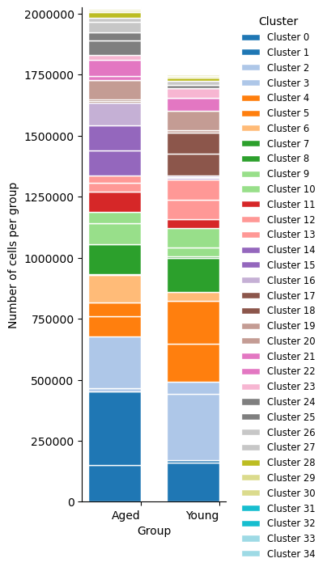

# Spectral Flow Cytometry Data Analysis

[](https://doi.org/10.4049/jimmunol.2400370)
[](LICENSE)
[](https://www.python.org/)

Analysis code for the spectral flow cytometry pipeline described in:

> Vardaman D III\*, **Ali MA**\*, Siam MHB, Bolding C, Tidwell H, Stephens HR, Patil M, Tyrrell DJ.
> *Development of a Spectral Flow Cytometry Analysis Pipeline for High-Dimensional Immune Cell Characterization.*
> The Journal of Immunology, 2024; 213(11): 1713–1724.
> [10.4049/jimmunol.2400370](https://doi.org/10.4049/jimmunol.2400370)
>
> \* These authors contributed equally.

The notebook applies single-cell analysis methods from `scanpy` to high-dimensional
spectral flow cytometry data. Unmixed events are loaded into an `AnnData` object,
embedded with UMAP, and clustered with the Leiden algorithm to characterize splenic
immune populations in young and aged mice.

## Related software: CAFÉ

This repository contains the original implementation of the pipeline, written while
the method was being developed. The approach was subsequently developed into CAFÉ, a
documented application with a graphical interface:

> Siam MHB, **Ali MA**, Vardaman D, Acharyya S, Patil M, Tyrrell DJ.
> *CAFÉ: an integrated web app for high-dimensional analysis and visualization in spectral flow cytometry.*
> Bioinformatics, 2025; 41(6): btaf176. [10.1093/bioinformatics/btaf176](https://doi.org/10.1093/bioinformatics/btaf176)
> (open access, CC BY 4.0)
>
> **Source code:** [github.com/mhbsiam/cafe](https://github.com/mhbsiam/cafe)

For new analyses, [CAFÉ](https://github.com/mhbsiam/cafe) is the recommended tool.
This repository preserves the analysis code behind the 2024 publication.

## Example results

| | |
|---|---|
|  |  |
| **Leiden clustering** of unmixed events, projected onto a UMAP embedding. | **Cluster abundance** compared between aged and young animals. |


*Expression of sixteen surface markers across the embedding, used to assign cluster identities.*


*Mean marker expression and the fraction of expressing cells per cluster, ordered by hierarchical clustering.*

All figures were generated by the notebook in this repository.

## Repository contents

```
notebooks/
  spleen-spectral-flow-analysis.ipynb   Main analysis notebook (66 code cells)
  spleen-spectral-flow-analysis.py      Script export of the notebook
  spleen-spectral-flow-analysis.html    Rendered notebook with all outputs
figures/                                Selected figures generated by the notebook
requirements.txt                        Python dependencies
```

The notebook is an analysis record and does not include explanatory text between
cells. The rendered HTML file shows every output without requiring the code to be run.

## Installation and usage

```bash
git clone https://github.com/mdakkasali/Spectral_Flow_Cytometry_Data_Analysis.git
cd Spectral_Flow_Cytometry_Data_Analysis
python3 -m venv .venv && source .venv/bin/activate
pip install -r requirements.txt
jupyter lab notebooks/spleen-spectral-flow-analysis.ipynb
```

### Input data

The source data are not included in this repository. The notebook reads unmixed
event tables exported from the spectral cytometer as CSV files, one per sample. Set
`folder_path` near the top of the notebook to the directory containing these files.
For data availability, see the statement in the publication or contact the
corresponding author.

### Analysis workflow

1. Load per-sample CSV exports and combine them into an `AnnData` object annotated by sample and age group
2. Apply ComBat correction and z-score scaling to each marker
3. Reduce dimensionality with principal component analysis
4. Construct a nearest-neighbor graph and compute a UMAP embedding
5. Identify cell populations with Leiden clustering
6. Rank markers for each cluster and order clusters by hierarchical clustering
7. Compare cluster abundance between aged and young animals

## Citation

If you use this code, please cite the publication:

```bibtex
@article{Vardaman2024SpectralFlow,
  title   = {Development of a Spectral Flow Cytometry Analysis Pipeline for
             High-Dimensional Immune Cell Characterization},
  author  = {Vardaman, III, Donald and Ali, Md Akkas and Siam, Md Hasanul Banna and
             Bolding, Chase and Tidwell, Harrison and Stephens, Holly R and
             Patil, Mallikarjun and Tyrrell, Daniel J},
  journal = {The Journal of Immunology},
  volume  = {213},
  number  = {11},
  pages   = {1713--1724},
  year    = {2024},
  doi     = {10.4049/jimmunol.2400370}
}
```

## Funding

The published study was supported by the National Institutes of Health
(R00 AG068309, P30 AI027767, P30 AG050886) and the American Federation for Aging
Research (A24063).

## Contact

**Md Akkas Ali**, PhD Candidate, Graduate Biomedical Sciences
Department of Pathology, University of Alabama at Birmingham
[mali3@uab.edu](mailto:mali3@uab.edu)

[Website](https://mdakkasali.github.io/) ·
[Google Scholar](https://scholar.google.com/citations?user=-qIZ0AgAAAAJ&hl=en) ·
[ORCID](https://orcid.org/0000-0002-3626-3393) ·
[Tyrrell Lab](https://sites.uab.edu/tyrrelllab/)

Please report questions or problems with the code as a
[GitHub issue](https://github.com/mdakkasali/Spectral_Flow_Cytometry_Data_Analysis/issues).

## License

The code is released under the [MIT License](LICENSE). The associated publication
is subject to the publisher's terms.
