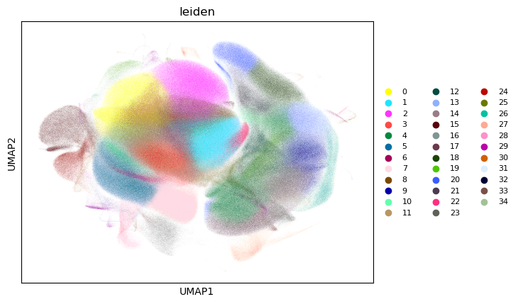
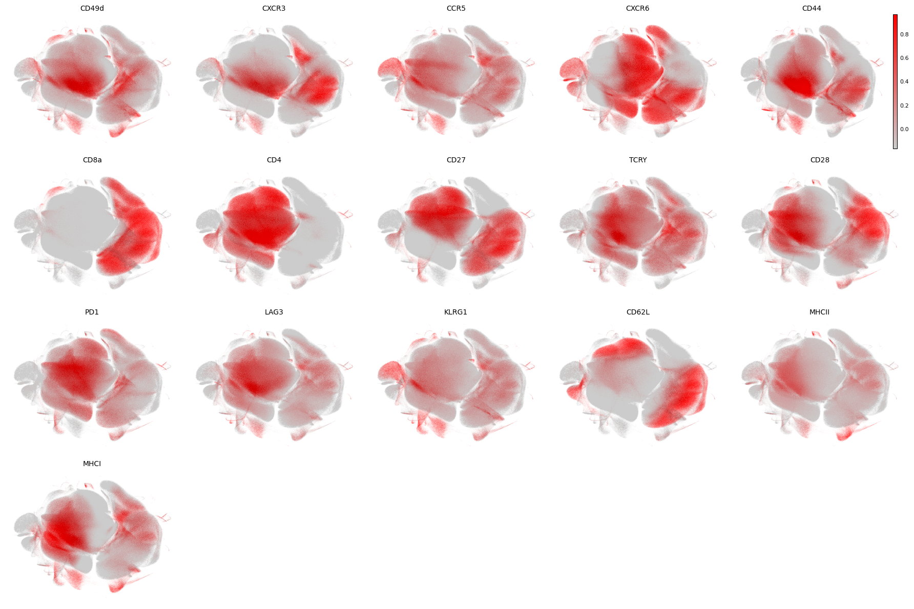
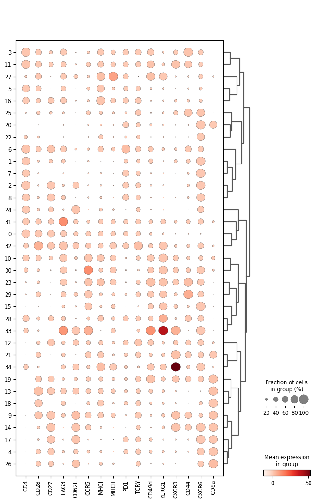

# Spectral Flow Cytometry Data Analysis

[](https://doi.org/10.4049/jimmunol.2400370)
[](LICENSE)
[](https://www.python.org/)

Analysis code for the spectral flow cytometry pipeline described in:

> Vardaman D III\*, **Ali MA**\*, Siam MHB, Bolding C, Tidwell H, Stephens HR, Patil M, Tyrrell DJ.
> *Development of a Spectral Flow Cytometry Analysis Pipeline for High-Dimensional Immune Cell Characterization.*
> The Journal of Immunology, 2024; 213(11): 1713–1724.
> [10.4049/jimmunol.2400370](https://doi.org/10.4049/jimmunol.2400370)
>
> \* These authors contributed equally.

The notebook here treats high-dimensional spectral flow cytometry data with tools
built for single-cell transcriptomics — loading unmixed events into an `AnnData`
object and applying PCA, UMAP, and Leiden clustering through `scanpy` — to
characterise murine splenic immune populations across young and aged animals.

## A note on what came next

This repository is the **original, exploratory implementation**, written while the
method was being developed. The approach was later rebuilt as a documented,
installable tool with a graphical interface:

> **CAFÉ** — Siam MHB, **Ali MA**, Vardaman D, Acharyya S, Patil M, Tyrrell DJ.
> *CAFÉ: an integrated web app for high-dimensional analysis and visualization in spectral flow cytometry.*
> Bioinformatics, 2025; 41(4). [10.1093/bioinformatics/btaf176](https://doi.org/10.1093/bioinformatics/btaf176)
> — open access under CC BY 4.0.

**If you want to run this kind of analysis on your own data, use CAFÉ.** It is
maintained, tested, and does not require reading someone else's notebook. This
repository is kept for provenance: it is the record of how the analysis in the
2024 paper was actually performed.

## Representative output

| | |
|---|---|
|  |  |
| **Leiden clustering** of unmixed events, projected onto a UMAP embedding. | **Cluster abundance** compared between aged and young animals. |


*Expression of sixteen surface markers across the embedding, used to assign cluster identities.*


*Mean marker expression and the fraction of expressing cells per cluster, ordered by hierarchical clustering.*

All figures were produced by the notebook in this repository.

## Contents

```
notebooks/
  spleen-spectral-flow-analysis.ipynb   Main analysis (66 code cells)
  spleen-spectral-flow-analysis.py      Script export of the same code
  spleen-spectral-flow-analysis.html    Rendered notebook with outputs
figures/                                Selected figures produced by the notebook
requirements.txt                        Python dependencies
```

The notebook is a working analysis record rather than a tutorial: it carries its
outputs but no written narrative between cells. Read `spleen-spectral-flow-analysis.html`
if you want to see the results without running anything.

## Running it

```bash
git clone https://github.com/mdakkasali/Spectral_Flow_Cytometry_Data_Analysis.git
cd Spectral_Flow_Cytometry_Data_Analysis
python3 -m venv .venv && source .venv/bin/activate
pip install -r requirements.txt
jupyter lab notebooks/spleen-spectral-flow-analysis.ipynb
```

### Data

**The source data is not in this repository.** The notebook reads unmixed event
tables exported from the spectral cytometer, which are too large to version here.
Paths at the top of the notebook point at a local directory and must be changed to
match your own files. For data availability, see the data availability statement in
the paper, or contact the corresponding author.

### Analysis steps

1. Load unmixed event tables and assemble them into an `AnnData` object
2. Scale and reduce dimensionality with PCA
3. Build a neighbourhood graph and embed with UMAP
4. Cluster with the Leiden algorithm
5. Rank markers per cluster and assign population identities
6. Compare cluster abundance between experimental groups

## Citation

If this code is useful in your work, please cite the paper rather than the
repository:

```bibtex
@article{Vardaman2024SpectralFlow,
  title   = {Development of a Spectral Flow Cytometry Analysis Pipeline for
             High-Dimensional Immune Cell Characterization},
  author  = {Vardaman, Donald and Ali, Md Akkas and Siam, Md Hasanul Banna and
             Bolding, Chase and Tidwell, Harrison and Stephens, Holly R and
             Patil, Mallikarjun and Tyrrell, Daniel J},
  journal = {The Journal of Immunology},
  volume  = {213},
  number  = {11},
  pages   = {1713--1724},
  year    = {2024},
  doi     = {10.4049/jimmunol.2400370}
}
```

## Funding

The published study was supported by the National Institutes of Health
(R00 AG068309, P30 AI027767, P30 AG050886) and the American Federation for Aging
Research (A24063), as recorded in the publication's Crossref metadata.

## Contact

**Md Akkas Ali** — PhD Candidate, Graduate Biomedical Sciences
Department of Pathology, University of Alabama at Birmingham
[mali3@uab.edu](mailto:mali3@uab.edu)

[Website](https://mdakkasali.github.io/) ·
[Google Scholar](https://scholar.google.com/citations?user=-qIZ0AgAAAAJ&hl=en) ·
[ORCID](https://orcid.org/0000-0002-3626-3393) ·
[Tyrrell Lab](https://sites.uab.edu/tyrrelllab/)

Questions about the code are best raised as an
[issue](https://github.com/mdakkasali/Spectral_Flow_Cytometry_Data_Analysis/issues).

## License

Released under the [MIT License](LICENSE). The code is covered by this license;
the associated publication is subject to the publisher's own terms.
